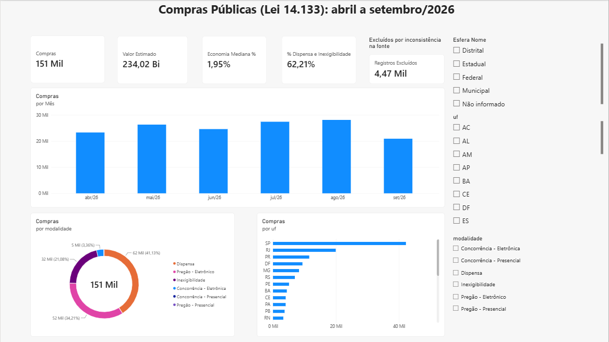
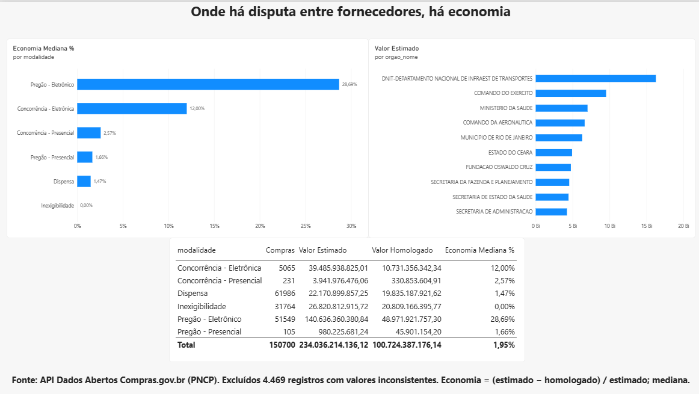

# Painel de Compras Públicas (PNCP)

Pipeline de dados que coleta as **contratações públicas da Lei 14.133/2021** publicadas no PNCP, grava num **PostgreSQL (Supabase)** e alimenta um **dashboard no Power BI**. As mesmas transformações e testes rodam em **dbt** tanto no PostgreSQL quanto no **BigQuery** (data warehouse do Google). O painel mostra volume, valores e economia (estimado × homologado) por modalidade, órgão, UF e mês.

```
API Compras.gov.br (PNCP) ──► etl.py ──► PostgreSQL/Supabase ──┬──► views SQL ──► Power BI
                                         public.contratacoes     ├──► dbt (schema analytics, 18 passos)
                                                                 └──► load_bigquery.py ──► BigQuery (pncp)
                                                                                            └──► dbt (dataset analytics, 18 passos)
```

## Fonte dos dados

[API de Dados Abertos do Compras.gov.br](https://dadosabertos.compras.gov.br/), no módulo de contratações do PNCP (endpoint `1_consultarContratacoes_PNCP_14133`). É pública e não exige cadastro.

O que foi descoberto testando a API e está tratado no ETL:
- A data final da consulta é **exclusiva**. Para pegar um dia, a consulta vai de `dia` até `dia + 1`.
- As páginas têm no máximo **500 registros**. Com `tamanhoPagina=1000`, a API responde erro 400.
- A API só retorna as modalidades **3** (Concorrência), **5** (Pregão Eletrônico), **6** (Dispensa) e **7** (Inexigibilidade).
- O volume é de cerca de **1.300 contratações por dia útil** no Brasil inteiro (01/09/2026: 1.323).

## ETL (`etl.py`)

- **Extração:** dia a dia e por modalidade, com paginação. Em erros 429/5xx e timeouts, tenta de novo com espera crescente (backoff exponencial).
- **Tratamento:**
  - descarta as compras marcadas como excluídas;
  - normaliza espaços nos textos;
  - converte as datas;
  - renomeia os campos para snake_case em português.
- **Carga:** faz *upsert* por `id_compra`, então reprocessar um dia não duplica registros. O commit é feito dia a dia, para que uma falha não perca os dias já carregados.
- **Incremental:** sem argumentos, recomeça do último dia carregado. Na primeira execução, carrega os últimos 180 dias.

O schema (`schema.sql`) cria a tabela `contratacoes` (dados brutos) e as views:
- `vw_contratacoes_validas` e `vw_qualidade`: regras de qualidade (veja abaixo);
- `vw_economia`: economia em R$ e em %, só para compras válidas com valor estimado e homologado;
- `vw_resumo_mensal`: quantidade de compras e valores por mês e modalidade.

## Transformações com dbt

As regras de negócio e de qualidade ficam versionadas como modelos **dbt** (pasta `dbt/`), materializados no schema `analytics`:

| Camada | Modelo | O que faz |
|---|---|---|
| source | `pncp.contratacoes` | tabela bruta carregada pelo `etl.py` |
| staging | `stg_contratacoes` (view) | nomes legíveis (esfera), colunas de data e mês |
| marts | `fct_contratacoes_validas` (tabela) | aplica as regras de qualidade e calcula a economia % |
| marts | `mart_economia_por_modalidade` | compras, valores e economia mediana por modalidade |
| marts | `mart_qualidade` | quantos registros cada regra excluiu |

O comando `dbt build` roda **18 passos**: 4 modelos e 14 testes de dados.
- **Testes genéricos:** `unique` e `not_null` no `id_compra`, e `accepted_values` na esfera.
- **Testes singulares em `dbt/tests/`**, com as regras do projeto:
  - nenhum registro válido acima de R$ 1 bilhão;
  - economia sempre entre 0% e 90%;
  - total menos excluídos igual aos válidos, para que nenhum registro suma sem explicação.

```bash
python -m venv .venv-dbt                   # dbt ainda não suporta Python 3.14: use 3.11/3.12
.venv-dbt\Scripts\pip install -r requirements-dbt.txt
.venv-dbt\Scripts\python run_dbt.py build   # lê a mesma DATABASE_URL do .env
.venv-dbt\Scripts\python run_dbt.py docs generate
```

O `run_dbt.py` repassa as credenciais do `.env` ao `profiles.yml` por variáveis de ambiente, então a senha não fica em nenhum arquivo versionado.

### O mesmo projeto dbt no BigQuery

Para praticar com um data warehouse na nuvem, o projeto também roda no **BigQuery** (sandbox gratuito):

```bash
.venv-dbt\Scripts\python load_bigquery.py                    # copia public.contratacoes → BigQuery (dataset pncp)
.venv-dbt\Scripts\python run_dbt.py build --target bigquery  # mesmos modelos e testes no BigQuery
```

- A autenticação usa uma **conta de serviço** do Google Cloud com os papéis *BigQuery Data Editor* e *BigQuery Job User*. A chave `.json` fica fora do repositório, em `~/.gcp/dbt-bigquery.json`.
- **O que muda entre os bancos:**
  - o schema da fonte é `public` no PostgreSQL e `pncp` no BigQuery, escolhido pelo `target.type`;
  - a data usa `cast(... as date)` e a macro `dbt.date_trunc`, que funcionam nos dois;
  - a **mediana** muda de sintaxe: no PostgreSQL é agregada (`percentile_cont ... within group`), no BigQuery só existe como função de janela (`percentile_cont(x, 0.5) over (...)`).
- **Resultado:** os dois bancos passam nos 18 passos, e a economia mediana por modalidade é **idêntica** nos dois (pregão 28,69%, dispensa 1,47%). Os 155.169 registros brutos chegam iguais, e 150.700 passam nas regras.

## Qualidade dos dados

Depois da primeira carga (155.169 contratações, de 01/04 a 24/09/2026), apareceram valores claramente digitados errado na fonte. Por exemplo, uma dispensa estimada em **R$ 3,9 trilhões** e homologada em **R$ 60 mil**. Apenas 70 registros acima de R$ 1 bilhão somavam **R$ 22,5 trilhões**, contra R$ 522 bilhões de todo o resto.

Regras aplicadas em `vw_contratacoes_validas`, sem apagar nada da tabela bruta:

| Regra | Registros excluídos |
|---|---|
| Valor estimado acima de R$ 1 bilhão | 70 |
| Economia fora de 0% a 90% (homologado maior que o estimado ou menor que 10% dele) | 4.399 |
| **Válidos para o painel** | **150.700** |

A view `vw_qualidade` recalcula esses números a cada carga. Mesmo depois do filtro, a economia é assimétrica: **mediana de 2,0%** contra média de 15,8%. Por isso o painel usa a mediana.

Outro ponto de atenção: nos meses mais recentes, o valor homologado é menor porque muitos processos ainda não terminaram. A comparação entre meses deve considerar isso.

## Como executar

```bash
python -m venv .venv
.venv\Scripts\activate            # Linux/Mac: source .venv/bin/activate
pip install -r requirements.txt
pytest                            # testes do tratamento e da paginação (não usam rede)

# Teste sem banco: um dia em CSV
python etl.py --csv amostra.csv --inicio 2026-09-01 --fim 2026-09-01

# Carga no Supabase
copy .env.example .env            # e preencha DATABASE_URL
python etl.py
```

A connection string fica **somente** no `.env`, que está no `.gitignore`.

## Dashboard (Power BI)

**Principal conclusão:** onde há disputa entre fornecedores, há economia.
- **Pregão Eletrônico:** economia mediana de **28,7%** sobre o valor estimado.
- **Concorrência Eletrônica:** 12,0%.
- **Dispensa:** 1,5%.
- **Inexigibilidade:** 0%.
- **62% das compras** do período foram feitas sem licitação (dispensa ou inexigibilidade).

### Visão geral


### Economia por modalidade e maiores órgãos


**Modelo:**
- A tabela `vw_contratacoes_validas` é importada do Supabase (conector PostgreSQL do Power BI) e ligada a uma tabela `Calendario` em DAX.
- **Medidas:** Compras, Valor Estimado, Valor Homologado, Economia R$, Economia Mediana % (`MEDIANX`), Ticket Médio, % Dispensa e Inexigibilidade e Registros Excluídos (a partir de `vw_qualidade`).
- **Página 1:** filtros por esfera, UF e modalidade.
- **Página 2:** o Brasil inteiro, com um filtro "N superior" de 10 órgãos.

**Conexão:** o certificado SSL do Supabase precisa estar instalado no Windows. Sem ele, o Power BI recusa a conexão com o erro "certificado remoto inválido".

## Tecnologias

Python (requests, psycopg), PostgreSQL / Supabase, BigQuery, SQL, dbt, pytest, Power BI.

Desenvolvido por Pedro Brandão Leal dos Santos, com apoio do **Claude Code** na escrita do código.
